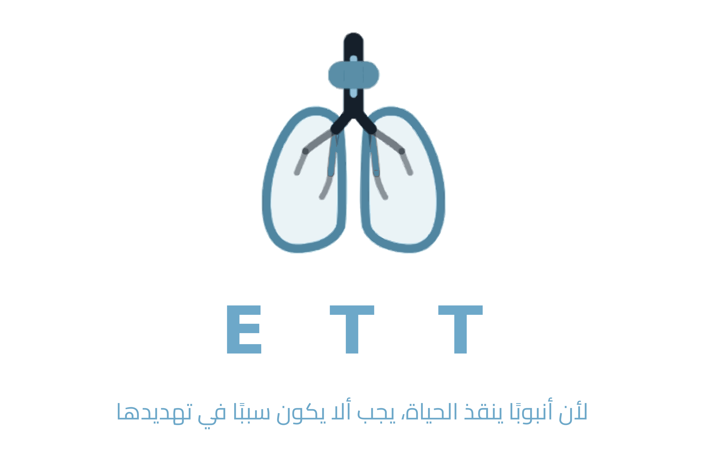

  

<h1 align="center">Smart ETT</h1>

<b>Why treat what we can prevent?</b> 
لأن أنبوبًا ينقذ الحياة، يجب ألا يكون سببًا في تهديدها

---

Bedside monitoring for endotracheal tubes in critical care. The nurse opens a unit, sees which intubated patients need attention, and for each patient gets cuff pressure, secretion assessment, a predicted probability of infection, the organisms most likely behind it, and a short list of actions to take and record.

Built by a respiratory-therapy and biomedical-engineering team in Riyadh. **Working prototype — fictional data, not a medical device.**

## Try it

Open **`index.html`** in any browser. No server, no install, no build step.

Or publish it with GitHub Pages: *Settings → Pages → Deploy from branch → `main` / root*. The app is the repository's `index.html`, so it goes live at `https://<user>.github.io/<repo>/`.

### Demo path

Login (any values) → **Adult ICU** → open **A. Alshamri** → tick *Suction now* and *Recalibrate cuff* → **تسجيل تنفيذ الإجراءات**.
Infection probability drops 78% → 42%, cuff returns to 24 cmH₂O, the patient moves from critical to watch, and the unit's critical counter falls by one.

## What's here

| Path | What it is |
|------|------------|
| `index.html` | The prototype: 6 units, 37 patients, live clinical logic, Arabic RTL interface. |
| `docs/PROJECT-BRIEF.md` | Intent, approved screens, clinical rules and thresholds, decision history, open questions, backlog. **Read this before changing anything.** |
| `docs/v1-static-screens.html` | The earlier static version of the four screens, kept for reference. |
| `presentation/Smart-ETT.pptx` | Six-slide pitch deck. |
| `assets/` | Logo in PNG (3000 px, transparent) and SVG. |

## How it works

Nothing about a patient's status is stored — it is all computed, so changing any value makes the whole interface follow.

- **Cuff pressure**: accepted range 20–30 cmH₂O; ≥32 or ≤17 critical, 31 or 18–19 warning. Neonatal tubes are uncuffed and skip this rule.
- **Infection probability**: secretion amount, colour, temperature, days intubated and trend, combined into a 0–92% score. ≥70 critical, 45–69 warning.
- **Likely organisms**: a fixed seven-pathogen list (*Pseudomonas aeruginosa, Klebsiella pneumoniae, Acinetobacter baumannii, Staphylococcus aureus / MRSA, Enterobacter spp., E. coli, Proteus spp.*) weighted per unit.
- **Actions**: generated from the patient's own state, and recording them writes back to the data.

All thresholds are placeholders and must be validated against hospital protocol. The prediction is decision support — culture and sensitivity remain the reference.

## Editing

Everything lives in `index.html`:

- patients → the `DEPTS` array at the top of the script
- thresholds → `infectionScore()`, `cuffState()`, `flagsOf()`, `statusOf()`, `tasksOf()`
- pathogen weights → the `germs` array on each department
- colours and type → the `:root` variables in the stylesheet

## Team

| | |
|---|---|
| Sarah Alharthi | Respiratory Therapy |
| Reem Almuhimed | Respiratory Therapy |
| Haya Alsufiyan | Biomedical Engineering |

## Status

Prototype for competition and pilot discussions. Not cleared for clinical use. Patient names, MRNs and values are invented.
